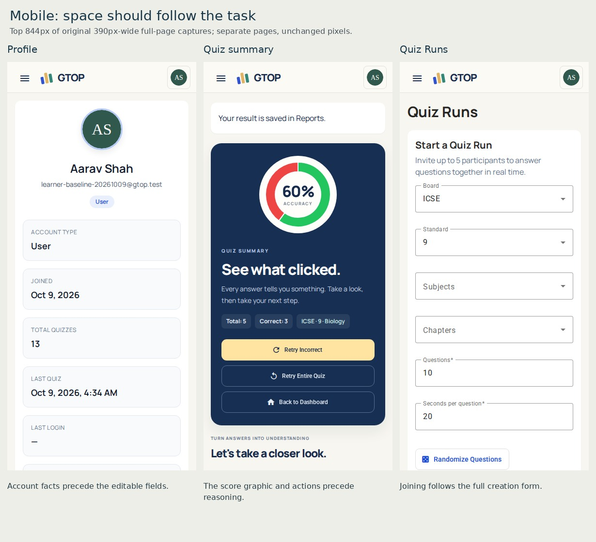
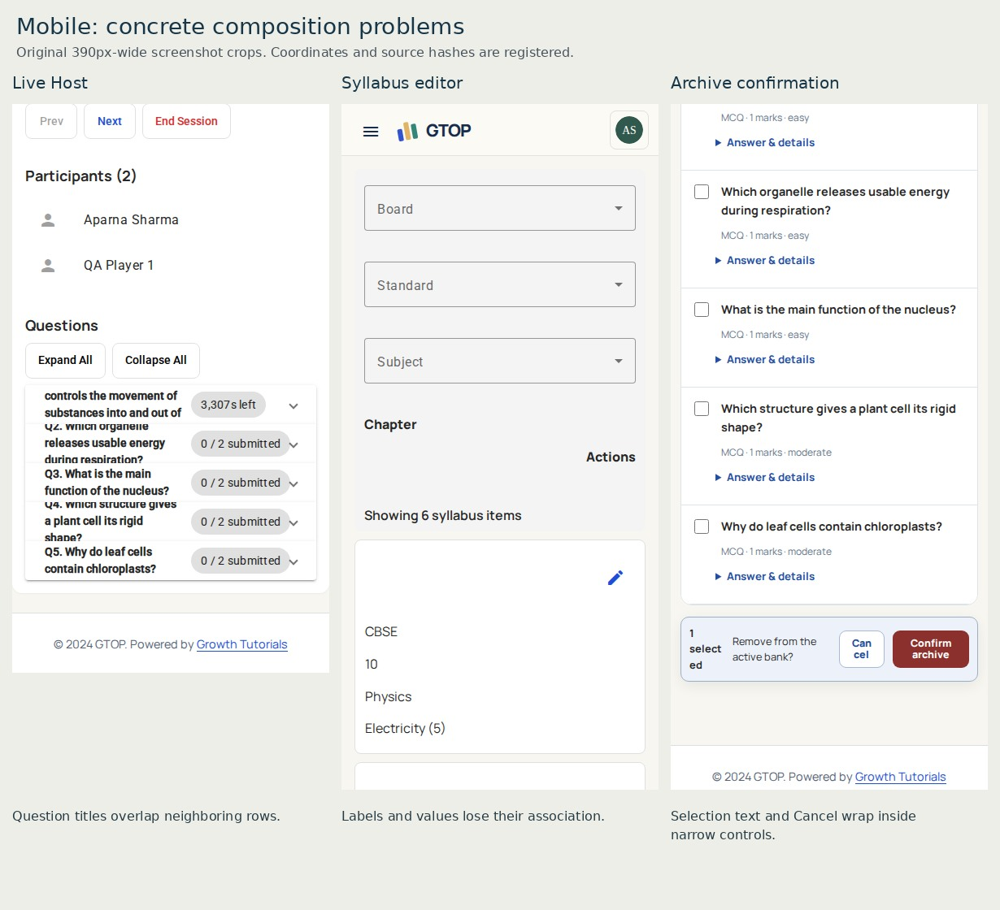

# GTOP screen evaluation

**Step 4 complete for review · 9 October 2026 · rubric 1.1.** All 39 included route entries were rated separately for desktop and mobile after inspecting 171 associated state pairs. Action Plan R23 remains excluded. No mockups or application changes were made.

The principal gap is uneven composition across the product: the landing and Plant Lab establish a stronger visual identity, while utility screens often prioritize metadata, navigation or repeated summaries ahead of the task. Mobile frequently inherits a long desktop stack; a few views also have concrete wrapping failures. The current paper workspace is relatively coherent and contains useful state language worth keeping.

Scores are evaluator judgments against named Step 3 properties, not Awwwards ratings or measured human preferences. A difference of a few tenths is not statistically meaningful. No whole-app average is used: aliases, specialist tools and learner flows have different purposes.

[Prioritized findings](findings.md) · [Step 5 brief](step-5-brief.md) · [Journey evidence and unscored limits](journeys.md) · [Method](method.md) · [Machine-readable assessments](assessments.json) · [Inspection ledger](inspection.json)

## All screen ratings

C/T/S/Color/Identity/Finish dimension ratings and exact screenshots are in each screen card. R05 shares R07’s assessment. Highest priorities remain visible even when a weighted score looks acceptable.

| ID | Screen | Desktop /10 | Mobile /10 | Highest finding |
|---|---|---:|---:|---|
| [R01](screens/R01.md) | Practice invitation | 6.4 | 6.1 | Moderate |
| [R02](screens/R02.md) | Invited quiz | 6.5 | 5.9 | Moderate |
| [R03](screens/R03.md) | Earlier paper requests | 4.4 | 4.4 | Major |
| [R04](screens/R04.md) | Saved question paper / key | 7.0 | 6.5 | Moderate |
| [R05](screens/R05.md) | Papers — all alias | 7.0 | 6.6 | Moderate |
| [R06](screens/R06.md) | New paper request | 7.0 | 6.6 | Moderate |
| [R07](screens/R07.md) | Paper register | 7.0 | 6.6 | Moderate |
| [R08](screens/R08.md) | Paper record / conversation | 7.0 | 6.6 | Moderate |
| [R09](screens/R09.md) | Question library | 5.8 | 4.8 | Major |
| [R10](screens/R10.md) | Question requests / coverage | 5.8 | 5.4 | Moderate |
| [R11](screens/R11.md) | Manual paper generator | 6.7 | 6.1 | Moderate |
| [R12](screens/R12.md) | Question review workbench | 6.0 | 5.6 | Moderate |
| [R13](screens/R13.md) | Learning Lab catalog | 6.7 | 6.3 | Moderate |
| [R14](screens/R14.md) | Plant reproduction lab | 7.7 | 7.1 | Moderate |
| [R15](screens/R15.md) | Plant results — admin | 5.9 | 4.8 | Moderate |
| [R16](screens/R16.md) | Current Lab | 6.7 | 6.2 | Moderate |
| [R17](screens/R17.md) | Current results — admin | 5.9 | 5.3 | Moderate |
| [R18](screens/R18.md) | Public landing | 7.9 | 7.4 | Moderate |
| [R19](screens/R19.md) | Profile setup | 5.5 | 5.2 | Moderate |
| [R20](screens/R20.md) | Profile | 5.2 | 4.8 | Moderate |
| [R21](screens/R21.md) | Learner dashboard | 6.8 | 6.4 | Moderate |
| [R22](screens/R22.md) | Admin console | 5.1 | 4.7 | Moderate |
| [R24](screens/R24.md) | Manage MCQs | 5.5 | 5.1 | Moderate |
| [R25](screens/R25.md) | Add / import MCQs | 4.9 | 4.5 | Moderate |
| [R26](screens/R26.md) | Manage syllabus | 5.5 | 5.1 | Moderate |
| [R27](screens/R27.md) | Syllabus review | 5.3 | 4.8 | Major |
| [R28](screens/R28.md) | Logs | 4.9 | 4.2 | Moderate |
| [R29](screens/R29.md) | Quiz — ordinary and active sessions | 6.6 | 6.5 | Moderate |
| [R30](screens/R30.md) | Quiz summary / review | 6.8 | 6.0 | Moderate |
| [R31](screens/R31.md) | Quiz Runs entry | 5.4 | 4.7 | Moderate |
| [R32](screens/R32.md) | Quiz Run lobby | 5.5 | 5.1 | Major |
| [R33](screens/R33.md) | Live Quizzes entry | 5.4 | 4.7 | Moderate |
| [R34](screens/R34.md) | Live Host | 4.9 | 3.4 | Major |
| [R35](screens/R35.md) | Live player lobby | 4.9 | 4.5 | Moderate |
| [R36](screens/R36.md) | Live leaderboard | 4.9 | 4.9 | Moderate |
| [R37](screens/R37.md) | Progress / reports | 5.2 | 4.8 | Moderate |
| [R38](screens/R38.md) | Edit syllabus | 4.4 | 3.7 | Major |
| [R39](screens/R39.md) | User management | 5.6 | 5.3 | Moderate |
| [R40](screens/R40.md) | Developer UI preview | 5.8 | 5.4 | Minor |

## Evidence examples

These are original screenshot crops, not proposed designs. [Crop/source register](boards.json). Sticky/full-page ambiguities are kept out of the confirmed-defect board.

## Acceptance and remaining evidence

All visual ratings are available. Ten bounded journey assessments retain observed dimension scores, but **every overall journey total is withheld** because recovery, repeated-use or other dimensions are incomplete. No full-flow pass or accessibility certification is implied. [Exact known/unknown boundary](journeys.md).

Before accepting affected designs, validate the mobile landing’s lower imagery and Plant Lab sticky scene with settled viewport captures; confirm legacy-paper records against representative data. Before development acceptance, test the relevant saved/resumed/error journeys, keyboard/focus, contrast, touch, motion preferences and device/browser behavior. These are specific follow-ups, not reasons to postpone the available visual analysis.

**Next decision:** review the priorities and Step 5 brief. Mockups begin when the baseline analysis is accepted as on track; development still requires acceptance of the proposed designs.
