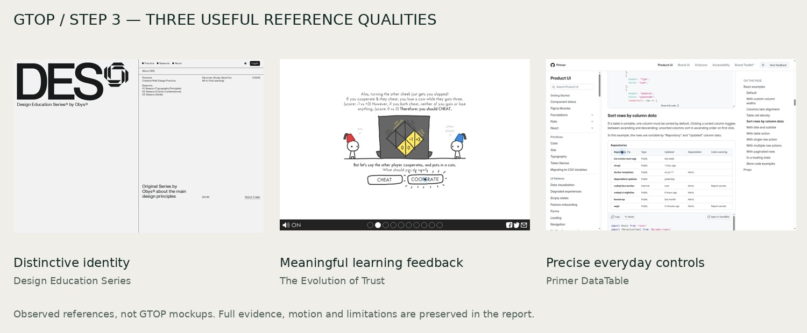

# Reference research — Step 3

**Completed for review · 9 October 2026.** Fifteen candidates screened, nine captured, seven core references retained. This stage supplies evidence-backed comparisons and criteria calibration; it does not assign GTOP scores or authorize development.

1. [Findings and GTOP relevance](report.md)
2. [Desktop/mobile visual gallery](gallery.md)
3. [Motion and scroll analysis](motion.md)
4. [Verified interactions and unresolved controls](interactions.md)
5. [Calibrated scoring anchors](calibration.md)
6. [Human appeal: evidence and limits](human-appeal.md)



## Core references

[Design Education Series](dossiers/des.md) · [twks](dossiers/twks.md) · [Linear](dossiers/linear.md) · [Bicycle](dossiers/bicycle.md) · [The Evolution of Trust](dossiers/trust.md) · [Primer DataTable](dossiers/primer.md) · [Brilliant](dossiers/brilliant.md)

Lando Norris and Igloo remain contextual/diagnostic captures because desktop rendering was incomplete. See the [full discovery shortlist](shortlist.md). No incomplete capture is scored as poor design.

## Permanent evidence

The [evidence register](evidence-register.json) indexes 259 original PNGs, 20 live-browser JPEGs and 39 video files, including superseded captures and diagnostics. Of the video files, 38 belong to finalized capture records and one is a partial file from the cancelled first pass. These counts do not represent successful benchmarks. There are also 24 derived boards, with source provenance, and eight selected live-browser states.

Originals remain under `evidence/2026-10-09/`; reports link directly to them. [Live observations](live-browser-observations.json), [motion sampling positions](motion-frames.json) and [first-pass index](first-pass-index.json) preserve context. SHA-256 checks cover every registered media file. A collaborator can verify the archive without loading any reference site:

```sh
python design-upgrade/references/capture-tools/verify.py
```

Python 3 and Pillow are required for verification. The [capture method](method.md), [generic capture script](capture-tools/capture.mjs), [interaction script](capture-tools/interactions.mjs) and dedicated manual GitHub Actions workflows preserve how the evidence was gathered. Exact historic files remain in git even as live websites change.

## Remaining evidence limits

Mobile evidence is Chromium emulation, not physical phones. Motion review uses recordings, sampled frames and observed state changes; no FPS, exact easing or formal accessibility certification is claimed. No student preference or learning-outcome study has been conducted. Brilliant's pause control could not be activated in the inspected path and is not used as a positive interaction benchmark. These boundaries are explicit in each dossier.

**Next:** review whether this reference base is on track, then perform Step 4's GTOP screen-by-screen evaluation. Criteria v1.1 adds named property anchors with unchanged weights and score-band meanings. Action Plan remains excluded. Mockups and application development remain at their later gates.
