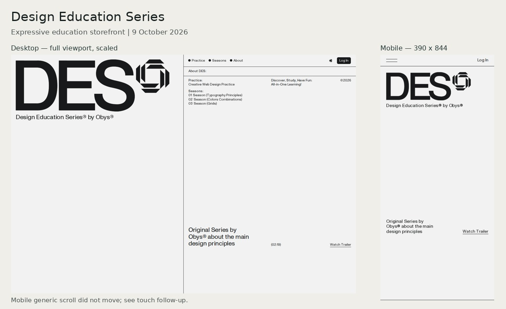
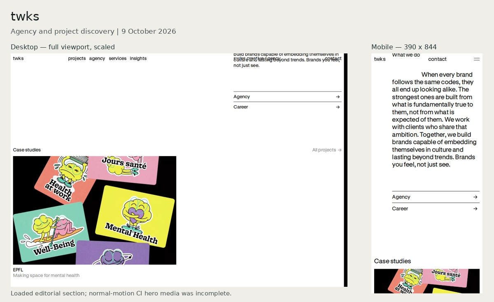
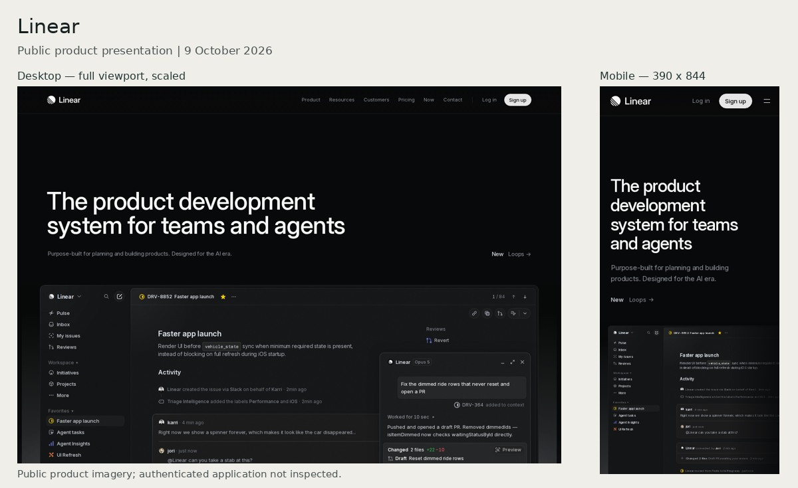
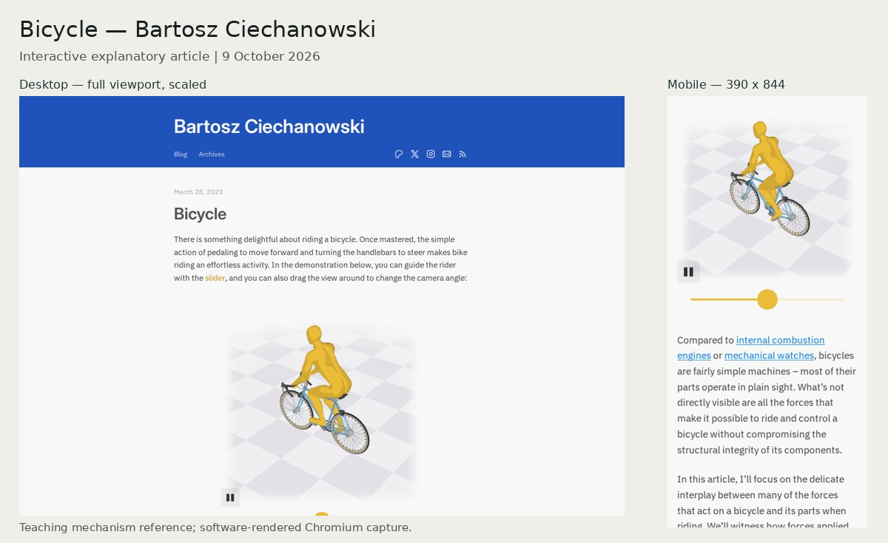
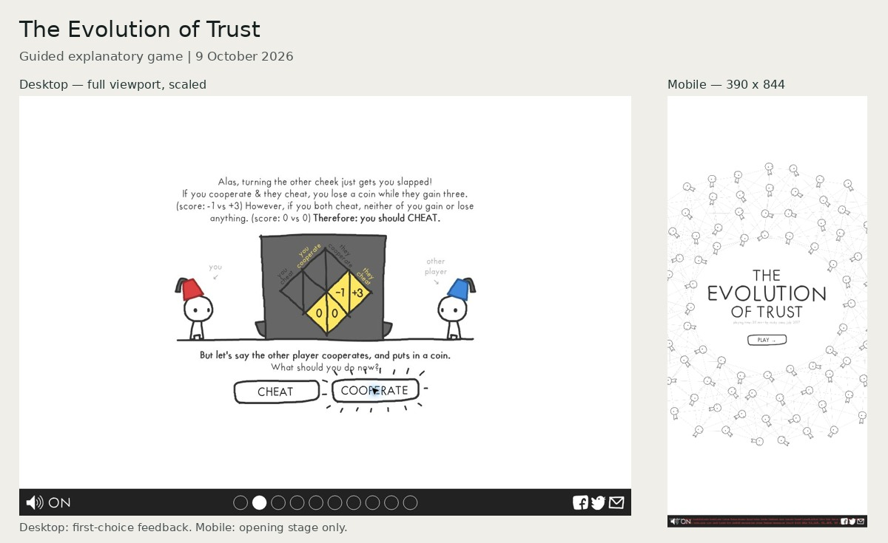
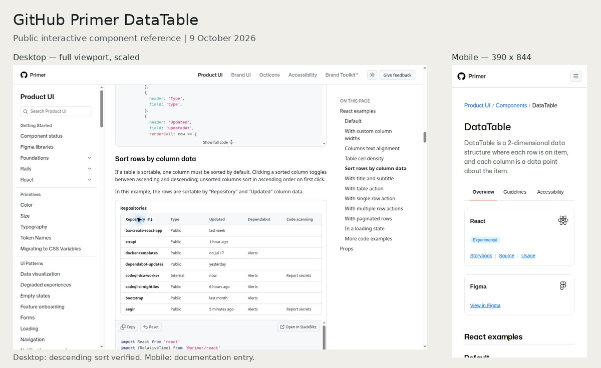
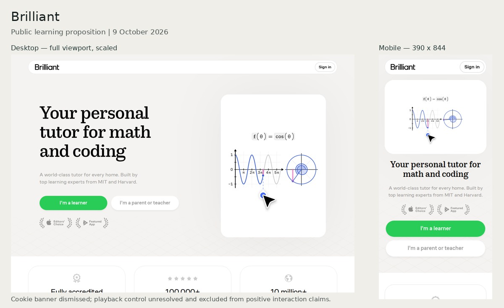

# Reference evidence gallery

9 October 2026. Seven core references. Boards are scaled views, not substitute originals. The source PNG/JPEG files and full recorded sequences are linked below. Capture attempts and incomplete states remain in the evidence register.

[Findings](report.md) · [Motion analysis](motion.md) · [Controls](interactions.md) · [Capture register](evidence-register.json)

## des

### Design Education Series

Expressive education storefront. [Aesthetic profile and limits](dossiers/des.md).

**Run 37894026455 / 1440px:** [action log](evidence/2026-10-09/run-37894026455/gtop-reference-des/run-37894026455/des/des/1440/record.json) · [01-entry](evidence/2026-10-09/run-37894026455/gtop-reference-des/run-37894026455/des/des/1440/01-entry.png) · [02-settled](evidence/2026-10-09/run-37894026455/gtop-reference-des/run-37894026455/des/des/1440/02-settled.png) · [03-scroll](evidence/2026-10-09/run-37894026455/gtop-reference-des/run-37894026455/des/des/1440/03-scroll.png) · [04-scroll](evidence/2026-10-09/run-37894026455/gtop-reference-des/run-37894026455/des/des/1440/04-scroll.png) · [05-scroll](evidence/2026-10-09/run-37894026455/gtop-reference-des/run-37894026455/des/des/1440/05-scroll.png) · [06-fast-scroll](evidence/2026-10-09/run-37894026455/gtop-reference-des/run-37894026455/des/des/1440/06-fast-scroll.png) · [07-reverse](evidence/2026-10-09/run-37894026455/gtop-reference-des/run-37894026455/des/des/1440/07-reverse.png) · [08-return](evidence/2026-10-09/run-37894026455/gtop-reference-des/run-37894026455/des/des/1440/08-return.png) · [09-reduced-motion-entry](evidence/2026-10-09/run-37894026455/gtop-reference-des/run-37894026455/des/des/1440/09-reduced-motion-entry.png) · [sequence](evidence/2026-10-09/run-37894026455/gtop-reference-des/run-37894026455/des/des/1440/sequence.webm)

**Run 37894026455 / 390px:** [action log](evidence/2026-10-09/run-37894026455/gtop-reference-des/run-37894026455/des/des/390/record.json) · [01-entry](evidence/2026-10-09/run-37894026455/gtop-reference-des/run-37894026455/des/des/390/01-entry.png) · [02-settled](evidence/2026-10-09/run-37894026455/gtop-reference-des/run-37894026455/des/des/390/02-settled.png) · [03-scroll](evidence/2026-10-09/run-37894026455/gtop-reference-des/run-37894026455/des/des/390/03-scroll.png) · [04-scroll](evidence/2026-10-09/run-37894026455/gtop-reference-des/run-37894026455/des/des/390/04-scroll.png) · [05-scroll](evidence/2026-10-09/run-37894026455/gtop-reference-des/run-37894026455/des/des/390/05-scroll.png) · [06-fast-scroll](evidence/2026-10-09/run-37894026455/gtop-reference-des/run-37894026455/des/des/390/06-fast-scroll.png) · [07-reverse](evidence/2026-10-09/run-37894026455/gtop-reference-des/run-37894026455/des/des/390/07-reverse.png) · [08-return](evidence/2026-10-09/run-37894026455/gtop-reference-des/run-37894026455/des/des/390/08-return.png) · [09-reduced-motion-entry](evidence/2026-10-09/run-37894026455/gtop-reference-des/run-37894026455/des/des/390/09-reduced-motion-entry.png) · [sequence](evidence/2026-10-09/run-37894026455/gtop-reference-des/run-37894026455/des/des/390/sequence.webm)

**Run 37895197290 / 390px:** [action log](evidence/2026-10-09/run-37895197290/gtop-interaction-des/run-37895197290/des/des/390/record.json) · [01-before-touch](evidence/2026-10-09/run-37895197290/gtop-interaction-des/run-37895197290/des/des/390/01-before-touch.png) · [02-touch-scroll](evidence/2026-10-09/run-37895197290/gtop-interaction-des/run-37895197290/des/des/390/02-touch-scroll.png) · [03-touch-scroll](evidence/2026-10-09/run-37895197290/gtop-interaction-des/run-37895197290/des/des/390/03-touch-scroll.png) · [04-touch-scroll](evidence/2026-10-09/run-37895197290/gtop-interaction-des/run-37895197290/des/des/390/04-touch-scroll.png) · [sequence](evidence/2026-10-09/run-37895197290/gtop-interaction-des/run-37895197290/des/des/390/sequence.webm)

## twks

### twks

Agency and project discovery. [Aesthetic profile and limits](dossiers/twks.md).

**Run 37894026455 / 1440px:** [action log](evidence/2026-10-09/run-37894026455/gtop-reference-twks/run-37894026455/twks/twks/1440/record.json) · [01-entry](evidence/2026-10-09/run-37894026455/gtop-reference-twks/run-37894026455/twks/twks/1440/01-entry.png) · [02-settled](evidence/2026-10-09/run-37894026455/gtop-reference-twks/run-37894026455/twks/twks/1440/02-settled.png) · [03-scroll](evidence/2026-10-09/run-37894026455/gtop-reference-twks/run-37894026455/twks/twks/1440/03-scroll.png) · [04-scroll](evidence/2026-10-09/run-37894026455/gtop-reference-twks/run-37894026455/twks/twks/1440/04-scroll.png) · [05-scroll](evidence/2026-10-09/run-37894026455/gtop-reference-twks/run-37894026455/twks/twks/1440/05-scroll.png) · [06-fast-scroll](evidence/2026-10-09/run-37894026455/gtop-reference-twks/run-37894026455/twks/twks/1440/06-fast-scroll.png) · [07-reverse](evidence/2026-10-09/run-37894026455/gtop-reference-twks/run-37894026455/twks/twks/1440/07-reverse.png) · [08-return](evidence/2026-10-09/run-37894026455/gtop-reference-twks/run-37894026455/twks/twks/1440/08-return.png) · [09-reduced-motion-entry](evidence/2026-10-09/run-37894026455/gtop-reference-twks/run-37894026455/twks/twks/1440/09-reduced-motion-entry.png) · [sequence](evidence/2026-10-09/run-37894026455/gtop-reference-twks/run-37894026455/twks/twks/1440/sequence.webm)

**Run 37894026455 / 390px:** [action log](evidence/2026-10-09/run-37894026455/gtop-reference-twks/run-37894026455/twks/twks/390/record.json) · [01-entry](evidence/2026-10-09/run-37894026455/gtop-reference-twks/run-37894026455/twks/twks/390/01-entry.png) · [02-settled](evidence/2026-10-09/run-37894026455/gtop-reference-twks/run-37894026455/twks/twks/390/02-settled.png) · [03-scroll](evidence/2026-10-09/run-37894026455/gtop-reference-twks/run-37894026455/twks/twks/390/03-scroll.png) · [04-scroll](evidence/2026-10-09/run-37894026455/gtop-reference-twks/run-37894026455/twks/twks/390/04-scroll.png) · [05-scroll](evidence/2026-10-09/run-37894026455/gtop-reference-twks/run-37894026455/twks/twks/390/05-scroll.png) · [06-fast-scroll](evidence/2026-10-09/run-37894026455/gtop-reference-twks/run-37894026455/twks/twks/390/06-fast-scroll.png) · [07-reverse](evidence/2026-10-09/run-37894026455/gtop-reference-twks/run-37894026455/twks/twks/390/07-reverse.png) · [08-return](evidence/2026-10-09/run-37894026455/gtop-reference-twks/run-37894026455/twks/twks/390/08-return.png) · [09-reduced-motion-entry](evidence/2026-10-09/run-37894026455/gtop-reference-twks/run-37894026455/twks/twks/390/09-reduced-motion-entry.png) · [sequence](evidence/2026-10-09/run-37894026455/gtop-reference-twks/run-37894026455/twks/twks/390/sequence.webm)

- [Live: Loaded live hero media](evidence/2026-10-09/twks-live-01.jpg)
- [Live: Public projects before filtering](evidence/2026-10-09/twks-live-02-projects.jpg)
- [Live: Digital filter applied, chip/count/reset and changed project set](evidence/2026-10-09/twks-live-03-filtered.jpg)

## linear

### Linear

Public product presentation. [Aesthetic profile and limits](dossiers/linear.md).

**Run 37894026455 / 1440px:** [action log](evidence/2026-10-09/run-37894026455/gtop-reference-linear/run-37894026455/linear/linear/1440/record.json) · [01-entry](evidence/2026-10-09/run-37894026455/gtop-reference-linear/run-37894026455/linear/linear/1440/01-entry.png) · [02-settled](evidence/2026-10-09/run-37894026455/gtop-reference-linear/run-37894026455/linear/linear/1440/02-settled.png) · [03-scroll](evidence/2026-10-09/run-37894026455/gtop-reference-linear/run-37894026455/linear/linear/1440/03-scroll.png) · [04-scroll](evidence/2026-10-09/run-37894026455/gtop-reference-linear/run-37894026455/linear/linear/1440/04-scroll.png) · [05-scroll](evidence/2026-10-09/run-37894026455/gtop-reference-linear/run-37894026455/linear/linear/1440/05-scroll.png) · [06-fast-scroll](evidence/2026-10-09/run-37894026455/gtop-reference-linear/run-37894026455/linear/linear/1440/06-fast-scroll.png) · [07-reverse](evidence/2026-10-09/run-37894026455/gtop-reference-linear/run-37894026455/linear/linear/1440/07-reverse.png) · [08-return](evidence/2026-10-09/run-37894026455/gtop-reference-linear/run-37894026455/linear/linear/1440/08-return.png) · [09-reduced-motion-entry](evidence/2026-10-09/run-37894026455/gtop-reference-linear/run-37894026455/linear/linear/1440/09-reduced-motion-entry.png) · [sequence](evidence/2026-10-09/run-37894026455/gtop-reference-linear/run-37894026455/linear/linear/1440/sequence.webm)

**Run 37894026455 / 390px:** [action log](evidence/2026-10-09/run-37894026455/gtop-reference-linear/run-37894026455/linear/linear/390/record.json) · [01-entry](evidence/2026-10-09/run-37894026455/gtop-reference-linear/run-37894026455/linear/linear/390/01-entry.png) · [02-settled](evidence/2026-10-09/run-37894026455/gtop-reference-linear/run-37894026455/linear/linear/390/02-settled.png) · [03-scroll](evidence/2026-10-09/run-37894026455/gtop-reference-linear/run-37894026455/linear/linear/390/03-scroll.png) · [04-scroll](evidence/2026-10-09/run-37894026455/gtop-reference-linear/run-37894026455/linear/linear/390/04-scroll.png) · [05-scroll](evidence/2026-10-09/run-37894026455/gtop-reference-linear/run-37894026455/linear/linear/390/05-scroll.png) · [06-fast-scroll](evidence/2026-10-09/run-37894026455/gtop-reference-linear/run-37894026455/linear/linear/390/06-fast-scroll.png) · [07-reverse](evidence/2026-10-09/run-37894026455/gtop-reference-linear/run-37894026455/linear/linear/390/07-reverse.png) · [08-return](evidence/2026-10-09/run-37894026455/gtop-reference-linear/run-37894026455/linear/linear/390/08-return.png) · [09-reduced-motion-entry](evidence/2026-10-09/run-37894026455/gtop-reference-linear/run-37894026455/linear/linear/390/09-reduced-motion-entry.png) · [sequence](evidence/2026-10-09/run-37894026455/gtop-reference-linear/run-37894026455/linear/linear/390/sequence.webm)

- [Live: Product menu expanded; Escape subsequently closed it](evidence/2026-10-09/linear-live-03-menu-settled.jpg)

## bicycle

### Bicycle — Bartosz Ciechanowski

Interactive explanatory article. [Aesthetic profile and limits](dossiers/bicycle.md).

**Run 37894026455 / 1440px:** [action log](evidence/2026-10-09/run-37894026455/gtop-reference-bicycle/run-37894026455/bicycle/bicycle/1440/record.json) · [01-entry](evidence/2026-10-09/run-37894026455/gtop-reference-bicycle/run-37894026455/bicycle/bicycle/1440/01-entry.png) · [02-settled](evidence/2026-10-09/run-37894026455/gtop-reference-bicycle/run-37894026455/bicycle/bicycle/1440/02-settled.png) · [03-scroll](evidence/2026-10-09/run-37894026455/gtop-reference-bicycle/run-37894026455/bicycle/bicycle/1440/03-scroll.png) · [04-scroll](evidence/2026-10-09/run-37894026455/gtop-reference-bicycle/run-37894026455/bicycle/bicycle/1440/04-scroll.png) · [05-scroll](evidence/2026-10-09/run-37894026455/gtop-reference-bicycle/run-37894026455/bicycle/bicycle/1440/05-scroll.png) · [06-fast-scroll](evidence/2026-10-09/run-37894026455/gtop-reference-bicycle/run-37894026455/bicycle/bicycle/1440/06-fast-scroll.png) · [07-reverse](evidence/2026-10-09/run-37894026455/gtop-reference-bicycle/run-37894026455/bicycle/bicycle/1440/07-reverse.png) · [08-return](evidence/2026-10-09/run-37894026455/gtop-reference-bicycle/run-37894026455/bicycle/bicycle/1440/08-return.png) · [09-reduced-motion-entry](evidence/2026-10-09/run-37894026455/gtop-reference-bicycle/run-37894026455/bicycle/bicycle/1440/09-reduced-motion-entry.png) · [sequence](evidence/2026-10-09/run-37894026455/gtop-reference-bicycle/run-37894026455/bicycle/bicycle/1440/sequence.webm)

**Run 37894026455 / 390px:** [action log](evidence/2026-10-09/run-37894026455/gtop-reference-bicycle/run-37894026455/bicycle/bicycle/390/record.json) · [01-entry](evidence/2026-10-09/run-37894026455/gtop-reference-bicycle/run-37894026455/bicycle/bicycle/390/01-entry.png) · [02-settled](evidence/2026-10-09/run-37894026455/gtop-reference-bicycle/run-37894026455/bicycle/bicycle/390/02-settled.png) · [03-scroll](evidence/2026-10-09/run-37894026455/gtop-reference-bicycle/run-37894026455/bicycle/bicycle/390/03-scroll.png) · [04-scroll](evidence/2026-10-09/run-37894026455/gtop-reference-bicycle/run-37894026455/bicycle/bicycle/390/04-scroll.png) · [05-scroll](evidence/2026-10-09/run-37894026455/gtop-reference-bicycle/run-37894026455/bicycle/bicycle/390/05-scroll.png) · [06-fast-scroll](evidence/2026-10-09/run-37894026455/gtop-reference-bicycle/run-37894026455/bicycle/bicycle/390/06-fast-scroll.png) · [07-reverse](evidence/2026-10-09/run-37894026455/gtop-reference-bicycle/run-37894026455/bicycle/bicycle/390/07-reverse.png) · [08-return](evidence/2026-10-09/run-37894026455/gtop-reference-bicycle/run-37894026455/bicycle/bicycle/390/08-return.png) · [09-reduced-motion-entry](evidence/2026-10-09/run-37894026455/gtop-reference-bicycle/run-37894026455/bicycle/bicycle/390/09-reduced-motion-entry.png) · [sequence](evidence/2026-10-09/run-37894026455/gtop-reference-bicycle/run-37894026455/bicycle/bicycle/390/sequence.webm)

**Run 37895197290 / 1440px:** [action log](evidence/2026-10-09/run-37895197290/gtop-interaction-bicycle/run-37895197290/bicycle/bicycle/1440/record.json) · [diagnostic](evidence/2026-10-09/run-37895197290/gtop-interaction-bicycle/run-37895197290/bicycle/bicycle/1440/diagnostic.png) · [sequence](evidence/2026-10-09/run-37895197290/gtop-interaction-bicycle/run-37895197290/bicycle/bicycle/1440/sequence.webm)

**Run 37895197290 / 390px:** [action log](evidence/2026-10-09/run-37895197290/gtop-interaction-bicycle/run-37895197290/bicycle/bicycle/390/record.json) · [01-slider-neutral](evidence/2026-10-09/run-37895197290/gtop-interaction-bicycle/run-37895197290/bicycle/bicycle/390/01-slider-neutral.png) · [02-slider-right](evidence/2026-10-09/run-37895197290/gtop-interaction-bicycle/run-37895197290/bicycle/bicycle/390/02-slider-right.png) · [03-slider-left](evidence/2026-10-09/run-37895197290/gtop-interaction-bicycle/run-37895197290/bicycle/bicycle/390/03-slider-left.png) · [sequence](evidence/2026-10-09/run-37895197290/gtop-interaction-bicycle/run-37895197290/bicycle/bicycle/390/sequence.webm)

**Run 37895866895 / 1440px:** [action log](evidence/2026-10-09/run-37895866895/gtop-interaction-bicycle/bicycle/bicycle/1440/record.json) · [01-slider-neutral](evidence/2026-10-09/run-37895866895/gtop-interaction-bicycle/bicycle/bicycle/1440/01-slider-neutral.png) · [02-slider-right](evidence/2026-10-09/run-37895866895/gtop-interaction-bicycle/bicycle/bicycle/1440/02-slider-right.png) · [03-slider-left](evidence/2026-10-09/run-37895866895/gtop-interaction-bicycle/bicycle/bicycle/1440/03-slider-left.png) · [sequence](evidence/2026-10-09/run-37895866895/gtop-interaction-bicycle/bicycle/bicycle/1440/sequence.webm)

**Run 37895866895 / 390px:** [action log](evidence/2026-10-09/run-37895866895/gtop-interaction-bicycle/bicycle/bicycle/390/record.json) · [01-slider-neutral](evidence/2026-10-09/run-37895866895/gtop-interaction-bicycle/bicycle/bicycle/390/01-slider-neutral.png) · [02-slider-right](evidence/2026-10-09/run-37895866895/gtop-interaction-bicycle/bicycle/bicycle/390/02-slider-right.png) · [03-slider-left](evidence/2026-10-09/run-37895866895/gtop-interaction-bicycle/bicycle/bicycle/390/03-slider-left.png) · [sequence](evidence/2026-10-09/run-37895866895/gtop-interaction-bicycle/bicycle/bicycle/390/sequence.webm)

## trust

### The Evolution of Trust

Guided explanatory game. [Aesthetic profile and limits](dossiers/trust.md).

**Run 37894026455 / 1440px:** [action log](evidence/2026-10-09/run-37894026455/gtop-reference-trust/run-37894026455/trust/trust/1440/record.json) · [01-entry](evidence/2026-10-09/run-37894026455/gtop-reference-trust/run-37894026455/trust/trust/1440/01-entry.png) · [02-settled](evidence/2026-10-09/run-37894026455/gtop-reference-trust/run-37894026455/trust/trust/1440/02-settled.png) · [03-scroll](evidence/2026-10-09/run-37894026455/gtop-reference-trust/run-37894026455/trust/trust/1440/03-scroll.png) · [04-scroll](evidence/2026-10-09/run-37894026455/gtop-reference-trust/run-37894026455/trust/trust/1440/04-scroll.png) · [05-scroll](evidence/2026-10-09/run-37894026455/gtop-reference-trust/run-37894026455/trust/trust/1440/05-scroll.png) · [06-fast-scroll](evidence/2026-10-09/run-37894026455/gtop-reference-trust/run-37894026455/trust/trust/1440/06-fast-scroll.png) · [07-reverse](evidence/2026-10-09/run-37894026455/gtop-reference-trust/run-37894026455/trust/trust/1440/07-reverse.png) · [08-return](evidence/2026-10-09/run-37894026455/gtop-reference-trust/run-37894026455/trust/trust/1440/08-return.png) · [09-reduced-motion-entry](evidence/2026-10-09/run-37894026455/gtop-reference-trust/run-37894026455/trust/trust/1440/09-reduced-motion-entry.png) · [sequence](evidence/2026-10-09/run-37894026455/gtop-reference-trust/run-37894026455/trust/trust/1440/sequence.webm)

**Run 37894026455 / 390px:** [action log](evidence/2026-10-09/run-37894026455/gtop-reference-trust/run-37894026455/trust/trust/390/record.json) · [01-entry](evidence/2026-10-09/run-37894026455/gtop-reference-trust/run-37894026455/trust/trust/390/01-entry.png) · [02-settled](evidence/2026-10-09/run-37894026455/gtop-reference-trust/run-37894026455/trust/trust/390/02-settled.png) · [03-scroll](evidence/2026-10-09/run-37894026455/gtop-reference-trust/run-37894026455/trust/trust/390/03-scroll.png) · [04-scroll](evidence/2026-10-09/run-37894026455/gtop-reference-trust/run-37894026455/trust/trust/390/04-scroll.png) · [05-scroll](evidence/2026-10-09/run-37894026455/gtop-reference-trust/run-37894026455/trust/trust/390/05-scroll.png) · [06-fast-scroll](evidence/2026-10-09/run-37894026455/gtop-reference-trust/run-37894026455/trust/trust/390/06-fast-scroll.png) · [07-reverse](evidence/2026-10-09/run-37894026455/gtop-reference-trust/run-37894026455/trust/trust/390/07-reverse.png) · [08-return](evidence/2026-10-09/run-37894026455/gtop-reference-trust/run-37894026455/trust/trust/390/08-return.png) · [09-reduced-motion-entry](evidence/2026-10-09/run-37894026455/gtop-reference-trust/run-37894026455/trust/trust/390/09-reduced-motion-entry.png) · [sequence](evidence/2026-10-09/run-37894026455/gtop-reference-trust/run-37894026455/trust/trust/390/sequence.webm)

- [Live: First choice before selecting Cooperate](evidence/2026-10-09/trust-live-02-choice.jpg)
- [Live: After Cooperate: explanation and highlighted consequence](evidence/2026-10-09/trust-live-03-feedback.jpg)

## primer

### GitHub Primer DataTable

Public interactive component reference. [Aesthetic profile and limits](dossiers/primer.md).

**Run 37894026455 / 1440px:** [action log](evidence/2026-10-09/run-37894026455/gtop-reference-primer/run-37894026455/primer/primer/1440/record.json) · [01-entry](evidence/2026-10-09/run-37894026455/gtop-reference-primer/run-37894026455/primer/primer/1440/01-entry.png) · [02-settled](evidence/2026-10-09/run-37894026455/gtop-reference-primer/run-37894026455/primer/primer/1440/02-settled.png) · [03-scroll](evidence/2026-10-09/run-37894026455/gtop-reference-primer/run-37894026455/primer/primer/1440/03-scroll.png) · [04-scroll](evidence/2026-10-09/run-37894026455/gtop-reference-primer/run-37894026455/primer/primer/1440/04-scroll.png) · [05-scroll](evidence/2026-10-09/run-37894026455/gtop-reference-primer/run-37894026455/primer/primer/1440/05-scroll.png) · [06-fast-scroll](evidence/2026-10-09/run-37894026455/gtop-reference-primer/run-37894026455/primer/primer/1440/06-fast-scroll.png) · [07-reverse](evidence/2026-10-09/run-37894026455/gtop-reference-primer/run-37894026455/primer/primer/1440/07-reverse.png) · [08-return](evidence/2026-10-09/run-37894026455/gtop-reference-primer/run-37894026455/primer/primer/1440/08-return.png) · [09-reduced-motion-entry](evidence/2026-10-09/run-37894026455/gtop-reference-primer/run-37894026455/primer/primer/1440/09-reduced-motion-entry.png) · [sequence](evidence/2026-10-09/run-37894026455/gtop-reference-primer/run-37894026455/primer/primer/1440/sequence.webm)

**Run 37894026455 / 390px:** [action log](evidence/2026-10-09/run-37894026455/gtop-reference-primer/run-37894026455/primer/primer/390/record.json) · [01-entry](evidence/2026-10-09/run-37894026455/gtop-reference-primer/run-37894026455/primer/primer/390/01-entry.png) · [02-settled](evidence/2026-10-09/run-37894026455/gtop-reference-primer/run-37894026455/primer/primer/390/02-settled.png) · [03-scroll](evidence/2026-10-09/run-37894026455/gtop-reference-primer/run-37894026455/primer/primer/390/03-scroll.png) · [04-scroll](evidence/2026-10-09/run-37894026455/gtop-reference-primer/run-37894026455/primer/primer/390/04-scroll.png) · [05-scroll](evidence/2026-10-09/run-37894026455/gtop-reference-primer/run-37894026455/primer/primer/390/05-scroll.png) · [06-fast-scroll](evidence/2026-10-09/run-37894026455/gtop-reference-primer/run-37894026455/primer/primer/390/06-fast-scroll.png) · [07-reverse](evidence/2026-10-09/run-37894026455/gtop-reference-primer/run-37894026455/primer/primer/390/07-reverse.png) · [08-return](evidence/2026-10-09/run-37894026455/gtop-reference-primer/run-37894026455/primer/primer/390/08-return.png) · [09-reduced-motion-entry](evidence/2026-10-09/run-37894026455/gtop-reference-primer/run-37894026455/primer/primer/390/09-reduced-motion-entry.png) · [sequence](evidence/2026-10-09/run-37894026455/gtop-reference-primer/run-37894026455/primer/primer/390/sequence.webm)

- [Live: Repository ascending, arrow and row order verified](evidence/2026-10-09/primer-live-04-sort-settled.jpg)
- [Live: Repository descending, arrow and row order verified](evidence/2026-10-09/primer-live-05-descending.jpg)

## brilliant

### Brilliant

Public learning proposition. [Aesthetic profile and limits](dossiers/brilliant.md).

**Run 37894026455 / 1440px:** [action log](evidence/2026-10-09/run-37894026455/gtop-reference-brilliant/run-37894026455/brilliant/brilliant/1440/record.json) · [01-entry](evidence/2026-10-09/run-37894026455/gtop-reference-brilliant/run-37894026455/brilliant/brilliant/1440/01-entry.png) · [02-settled](evidence/2026-10-09/run-37894026455/gtop-reference-brilliant/run-37894026455/brilliant/brilliant/1440/02-settled.png) · [03-scroll](evidence/2026-10-09/run-37894026455/gtop-reference-brilliant/run-37894026455/brilliant/brilliant/1440/03-scroll.png) · [04-scroll](evidence/2026-10-09/run-37894026455/gtop-reference-brilliant/run-37894026455/brilliant/brilliant/1440/04-scroll.png) · [05-scroll](evidence/2026-10-09/run-37894026455/gtop-reference-brilliant/run-37894026455/brilliant/brilliant/1440/05-scroll.png) · [06-fast-scroll](evidence/2026-10-09/run-37894026455/gtop-reference-brilliant/run-37894026455/brilliant/brilliant/1440/06-fast-scroll.png) · [07-reverse](evidence/2026-10-09/run-37894026455/gtop-reference-brilliant/run-37894026455/brilliant/brilliant/1440/07-reverse.png) · [08-return](evidence/2026-10-09/run-37894026455/gtop-reference-brilliant/run-37894026455/brilliant/brilliant/1440/08-return.png) · [09-reduced-motion-entry](evidence/2026-10-09/run-37894026455/gtop-reference-brilliant/run-37894026455/brilliant/brilliant/1440/09-reduced-motion-entry.png) · [sequence](evidence/2026-10-09/run-37894026455/gtop-reference-brilliant/run-37894026455/brilliant/brilliant/1440/sequence.webm)

**Run 37894026455 / 390px:** [action log](evidence/2026-10-09/run-37894026455/gtop-reference-brilliant/run-37894026455/brilliant/brilliant/390/record.json) · [01-entry](evidence/2026-10-09/run-37894026455/gtop-reference-brilliant/run-37894026455/brilliant/brilliant/390/01-entry.png) · [02-settled](evidence/2026-10-09/run-37894026455/gtop-reference-brilliant/run-37894026455/brilliant/brilliant/390/02-settled.png) · [03-scroll](evidence/2026-10-09/run-37894026455/gtop-reference-brilliant/run-37894026455/brilliant/brilliant/390/03-scroll.png) · [04-scroll](evidence/2026-10-09/run-37894026455/gtop-reference-brilliant/run-37894026455/brilliant/brilliant/390/04-scroll.png) · [05-scroll](evidence/2026-10-09/run-37894026455/gtop-reference-brilliant/run-37894026455/brilliant/brilliant/390/05-scroll.png) · [06-fast-scroll](evidence/2026-10-09/run-37894026455/gtop-reference-brilliant/run-37894026455/brilliant/brilliant/390/06-fast-scroll.png) · [07-reverse](evidence/2026-10-09/run-37894026455/gtop-reference-brilliant/run-37894026455/brilliant/brilliant/390/07-reverse.png) · [08-return](evidence/2026-10-09/run-37894026455/gtop-reference-brilliant/run-37894026455/brilliant/brilliant/390/08-return.png) · [09-reduced-motion-entry](evidence/2026-10-09/run-37894026455/gtop-reference-brilliant/run-37894026455/brilliant/brilliant/390/09-reduced-motion-entry.png) · [sequence](evidence/2026-10-09/run-37894026455/gtop-reference-brilliant/run-37894026455/brilliant/brilliant/390/sequence.webm)

**Run 37895197290 / 1440px:** [action log](evidence/2026-10-09/run-37895197290/gtop-interaction-brilliant/run-37895197290/brilliant/brilliant/1440/record.json) · [01-clean-entry](evidence/2026-10-09/run-37895197290/gtop-interaction-brilliant/run-37895197290/brilliant/brilliant/1440/01-clean-entry.png) · [diagnostic](evidence/2026-10-09/run-37895197290/gtop-interaction-brilliant/run-37895197290/brilliant/brilliant/1440/diagnostic.png) · [sequence](evidence/2026-10-09/run-37895197290/gtop-interaction-brilliant/run-37895197290/brilliant/brilliant/1440/sequence.webm)

**Run 37895197290 / 390px:** [action log](evidence/2026-10-09/run-37895197290/gtop-interaction-brilliant/run-37895197290/brilliant/brilliant/390/record.json) · [01-clean-entry](evidence/2026-10-09/run-37895197290/gtop-interaction-brilliant/run-37895197290/brilliant/brilliant/390/01-clean-entry.png) · [diagnostic](evidence/2026-10-09/run-37895197290/gtop-interaction-brilliant/run-37895197290/brilliant/brilliant/390/diagnostic.png) · [sequence](evidence/2026-10-09/run-37895197290/gtop-interaction-brilliant/run-37895197290/brilliant/brilliant/390/sequence.webm)

**Run 37895866895 / 1440px:** [action log](evidence/2026-10-09/run-37895866895/gtop-interaction-brilliant/brilliant/brilliant/1440/record.json) · [01-clean-entry](evidence/2026-10-09/run-37895866895/gtop-interaction-brilliant/brilliant/brilliant/1440/01-clean-entry.png) · [diagnostic](evidence/2026-10-09/run-37895866895/gtop-interaction-brilliant/brilliant/brilliant/1440/diagnostic.png) · [sequence](evidence/2026-10-09/run-37895866895/gtop-interaction-brilliant/brilliant/brilliant/1440/sequence.webm)

**Run 37895866895 / 390px:** [action log](evidence/2026-10-09/run-37895866895/gtop-interaction-brilliant/brilliant/brilliant/390/record.json) · [01-clean-entry](evidence/2026-10-09/run-37895866895/gtop-interaction-brilliant/brilliant/brilliant/390/01-clean-entry.png) · [diagnostic](evidence/2026-10-09/run-37895866895/gtop-interaction-brilliant/brilliant/brilliant/390/diagnostic.png) · [sequence](evidence/2026-10-09/run-37895866895/gtop-interaction-brilliant/brilliant/brilliant/390/sequence.webm)

## Context and diagnostics

Lando and Igloo are not complete desktop/mobile anchors. Their partial captures, the superseded first pass and intermediate browser screenshots are indexed in [the evidence register](evidence-register.json) and [live observation register](live-browser-observations.json). Do not infer a site defect from a capture timeout or unavailable graphics context.
