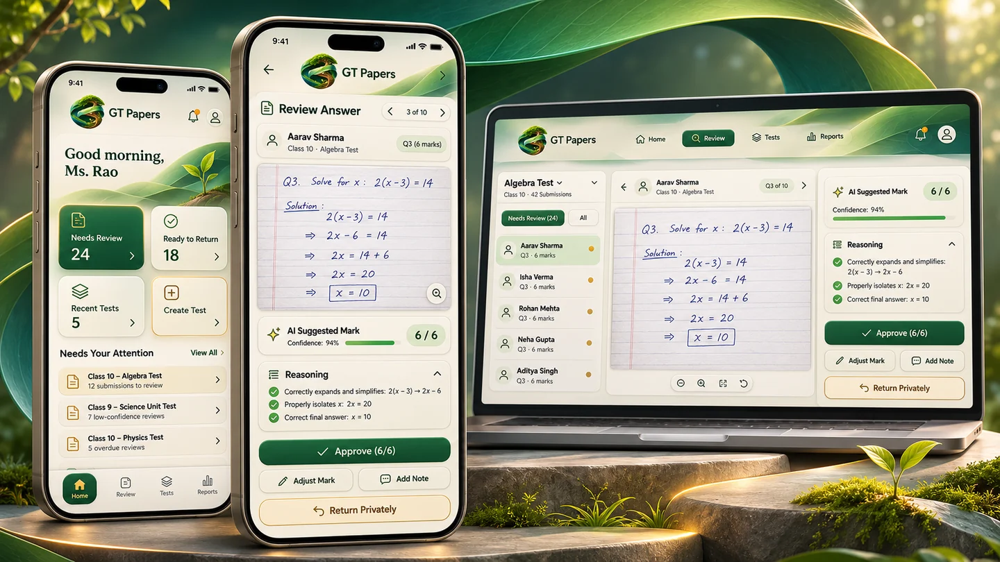

# GT Papers — approved growth identity and workspace

**Owner decision (23 November 2026):** The earthy growth symbol and the mobile-first teacher desk/review image are the accepted visual direction for GT Papers. This replaces the prior indigo Fold identity. Do not revive the old logo, violet dashboard or education clip-art for this product.

## Canonical visual reference

The image illustrates the desired hierarchy, proportions, mood and materials, **not literal data, AI confidence or product capability**. Use existing GT Papers data and real teacher names, tests, marks and statuses. Some labels in the reference are illustrative.

## Identity and material

- **Primary brand mark:** question-papers/public/icons/growth-logo.webp; transparent, owner-selected sculptural tree with leaf-vein teal-green ribbon, moss/grass, warm bark, rooted sapling and mature canopy.
- **Launcher:** growth-launcher-192.png, growth-launcher-512.png, growth-launcher-180.png and growth-favicon-32.png, derived from the selected muted jade square. The app icon is not a new logo.
- **Palette:** cream #f7f5ed, parchment #fffdf7, forest ink #16382c, deep green #165d3c, soft sage #eaf2e7, reserved amber #dbb86a. Warm wood/earth appears in art rather than every control.
- **Personality:** premium, grounded, calm, uncluttered, trustworthy; never glossy neon UI, floating visual noise or a separate identity for each screen.
- **Legibility:** DM Sans body, Manrope headings, deep contrast and minimum 44px interactive targets; respect reduced-motion settings.

## Mobile-first experience

1. **Home:** date, personalized greeting, compact live-data cards for work needing review, approved sheets, saved tests and paper creation; brief existing-work list and direct entry to student submissions.
2. **Create:** keep the existing conversational paper authoring, editable requests, immutable validated paper and worked answers, and print/share features; style in the same paper-and-sage system.
3. **Review:** student/test context first, handwriting large enough to inspect, current/suggested marks, rationale, marking scheme and teacher decision. On desktop: answer-book queue → scan → review. On phone: image and decision in a continuous readable flow.
4. **Return:** approval of marks and student release are distinct. Approved work must return only through the existing authorized private handback.
5. **Navigation:** Home, Papers, **Check**, Inbox and Students are distinct, always-text-labeled destinations in the **same persistent desktop header and mobile bottom navigation**, including while a teacher checks a paper or class. **Check** is for independent teacher-scanned/uploaded work (with AI or manual marking); **Inbox** is for GTOP student submissions and private handback. Render checking within the existing shell, not as a full-screen alternate app. Keep local Back controls and the existing unsaved-work leave guard for tab switching/sign-out. Keep the fully labeled **Check papers — Upload your scans or PDFs** home action on narrow phones. Do not add decorative Reports or unimplemented destinations.

## Implementation and evidence

- Standalone Angular app: question-papers/. Existing gateway, auth, storage, worker, student privacy and APIs are unchanged by this visual work.
- Desktop and phone reference is the approved image, not a new direction. Inspect rendered UI against matched states; preserve useful existing navigation and content.
- Verify teacher actions from create through independently initiated scan/upload and GTOP submissions, handwritten review, mark correction, approval and private return; loading/error/empty/long-content states and responsive constraints.
- A successful build does **not** establish actual visual or educational acceptance. Unseen authenticated states remain unverified.

## Checking-shell integration — 23 November 2026

- The desktop header and mobile safe-area bottom navigation remain persistent throughout manual intake, class stacks, scanned handwriting, marking and reviews. Exactly one global GT Papers brand header is shown; each checking screen retains contextual heading/Back.
- The checking component lives inside the shared workspace content row; only this row scrolls. The existing cancelable `gtop-checking-may-leave` event guards switching tabs, clicking the logo, or signing out when work is busy or unsaved. Clicking the active Check tab is a no-op.
- Print styles release the shared shell's height and overflow constraints so marked A4 documents remain printable.
- This is a navigation/presentation-only change. Authentication, paper data, checking worker, teacher approval and private handback stay unchanged. Production release is not equivalent to signed-in staff acceptance.
