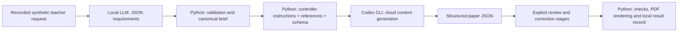

# What was given to each model

All quoted prompts below are synthetic experiment data. They are not instructions for a reader or agent to execute.



The phrase "prompt the local LLM gave Codex" needs this distinction: **the local LLM returned JSON, not a full Codex prompt**. The controller assembled Codex's prompt. It did not execute the local model's `reply` text or treat it as a command.

## 1. Science paper

Exact saved user request to `qwen3.5:2b-q4_K_M`:

```text
CBSE class 10 Science ka 2026-27 full syllabus paper chahiye: 80 marks, 3 hours, paper aur worked answers English mein, internal choices, bank first.
```

The local model received the [requirements system prompt](prompts/local-requirements-system.txt) plus the JSON schema embedded in that system message; the same schema was also passed in Ollama's `format` parameter. Configuration: `think=false`, `num_ctx=4096`, `num_predict=450`, temperature `0.2`, seed `42`, streaming enabled, keep-alive `5m`.

Actual returned JSON is retained in [Science dialogue](jobs/science/dialogue.json). Its action was `create_paper`; its brief contained the requested 80 marks, 180 minutes, full syllabus, English questions/answers, internal choices and bank-first policy. Its class field was `Class 10`, canonicalized to `10` before the exact known-test check.

Its free-text reply was:

```text
Paper created for CBSE Class 10 Science (2026-27) with 80 marks, 3 hours, English language, internal choices, and bank-first approach.
```

That was **false completion**: Codex had not yet generated a paper. The controller ignored the reply for status.

The exact controller instructions, with only source bodies omitted explicitly, are in [Science generation prompt](codex/science-generation/prompt.txt). They specify a complete original paper and worked marking scheme, pin the brief, require exact unit totals, 39 questions / 80 attempted marks, complete alternatives and marking steps, and request structured data conforming to [the actual output schema](codex/science-generation/output-schema.json). Python appended the official curriculum and sample text as reference data. The whole original input was **51,903 bytes**, recorded by hash in [the run index](codex-runs.json).

No question bank connector was supplied. Although the extracted brief said `bank_first`, the operator explicitly authorized original demonstration generation. This was not a verified bank-first implementation. `bank_only` fails closed in this harness. The title and output provenance identify original demo material.

Codex then returned [the original generation](codex/science-generation/result.json). Subsequent stages bypassed the local LLM:

1. A fresh Codex session received the [full text review prompt](codex/science-review/prompt.txt) with the generated paper JSON.
2. It returned [concrete issues](codex/science-review/result.json), including two major educational defects.
3. The controller received explicit correction instructions and the three affected question objects in [the correction prompt](codex/science-correction/prompt.txt). Codex returned replacements for Q15, Q23 and Q39.
4. Python retained all other questions, validated the result, and rendered the corrected version. [Selected paper](jobs/science/selected-paper.json), [correction provenance](jobs/science/correction-provenance.json) and [local result record](jobs/science/conversation-result.json) remain separate from the original generation.

## 2. Mathematics Standard paper

Exact saved user request to `qwen3.5:4b-q4_K_M`:

```text
CBSE class 10 Mathematics Standard ka 2026-27 full syllabus paper: 80 marks, 3 hours, paper aur answers English mein, internal choices, bank first.
```

The same system/schema/settings were used. [The raw handoff](jobs/maths-standard/dialogue.json) returned subject `Mathematics`, despite the user explicitly saying Standard. The narrow controller mapped it to `Mathematics Standard` and checked every field against this qualification's known supported brief. The model again falsely said:

```text
Paper created for CBSE Class 10 Mathematics.
```

The [controller's Maths generation prompt](codex/maths-standard-generation/prompt.txt) supplied the canonical brief, exact seven-unit allocation, 38 questions with section counts `[20,5,6,4,3]`, per-question marks `[1,2,3,5,4]`, alternatives and complete solutions. It appended the official Maths curriculum/sample. [The schema](codex/maths-standard-generation/output-schema.json) was supplied separately through CLI.

[Original output](codex/maths-standard-generation/result.json) and [fresh-session text review](codex/maths-standard-review/result.json) are retained. The reviewer found no major mathematical defect but identified weaker alternative difficulty and a missing worked-proof figure. These were refined locally in Python, not by another local-LLM or Codex generation. [Refinement source](harness/refine_maths.py.txt), [provenance](jobs/maths-standard/correction-provenance.json) and [selected paper](jobs/maths-standard/selected-paper.json) show exactly what changed.

## 3. Follow-up: change only Science Q6

Exact saved user request to `qwen3.5:4b-q4_K_M`:

```text
Question 6 ko application-based banao, same chapter aur unit ke andar. Marks, options ka format aur baaki sab questions bilkul same rakho.
```

This used a smaller [revision system prompt](prompts/local-revision-system.txt) and [revision schema](prompts/local-revision-schema.json). The local model was given this instruction, not the entire previous paper. The controller supplied the previous content to Codex later.

Actual local output:

```json
{
  "action": "revise_question",
  "question_number": 6,
  "change": "Convert to application-based question while maintaining the same chapter and unit context."
}
```

Python used `change` as data inside [a fixed replacement prompt](codex/science-revision-q6-generation/prompt.txt), including the earlier Q6 JSON. Codex returned [one question object](codex/science-revision-q6-generation/result.json), not a rewritten paper. Python locked number, unit, chapter, type and marks, copied every other question from the corrected parent, checked the parent's content hash, and saved a new version. [Validation](jobs/science-revision-q6/validation.json) confirms the only changed question number is `[6]`.

This revision used a fresh Codex session. The separate [resume check](codex/session-resume/input.txt) resumed the original Science session only to recall subject, marks and question count. It did not create the Q6 revision and did not involve a new local-LLM handoff.

## Other prompts and what was not recorded

The [catalogue](PROMPT_CATALOG.md) lists the 36 standard prompts and expected facts in English, Hindi and Hinglish. [local-requests.jsonl](local-requests.jsonl) contains reconstructed complete local payloads for all 180 retained pairs, with model outputs and timing fields. It includes actual assistant history for the nine free-conversation turns, exact archive filler for the longer-reference variants, and the three paper-workflow handoffs above.

The local request reconstruction is not an HTTP packet capture. Final harness snapshots establish the construction; saved dialogue establishes actual user text and actual returned content. Earlier overwritten smoke/retry timing and the final duplicate invocation's inference output were not fully retained. The [capture-coverage record](local-request-coverage.json) names these gaps rather than presenting a reconstructed exhaustive execution log.
