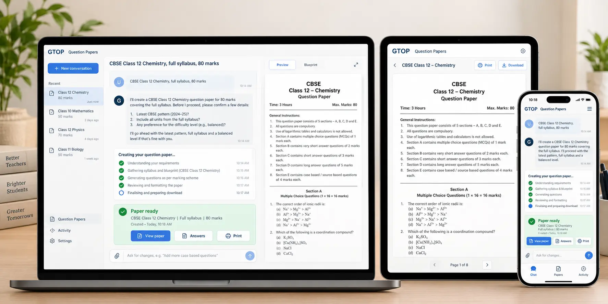

# GTOP Question Papers — Multi-device concept

**Status:** Visual reference, generated 24 October 2026. This is not implemented UI or an approved final specification.

**Experience to preserve**
- A human-facing chat is the primary way to request, clarify and revise a paper.
- Recent conversations remain discoverable without long dropdowns.
- Actual harness/Codex job states appear within the conversation; never fabricate progress.
- A completed job provides a printable student paper, separate worked answers and revision actions.
- On mobile, compose, open results and return to the conversation with thumb-reachable controls.
- Keep the dedicated Question Papers site visually consistent with the uncluttered GTOP core and accessible on desktop, tablet and phone.

**Design is exploratory.** The mocked exam wording, timestamps, sample questions and section marks are illustrative only. Validate curriculum, question patterns, equations, marks totals and rendered printing against actual task requirements. Do not infer completed functions or backend contracts from pixels. Plan a minimal, testable vertical slice before building.
