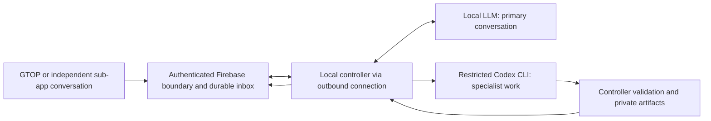

# Proposed architecture after role experiments

**Status: proposed for approval, not a deployed architecture or a final model selection.** This implements the latest role clarification in the design. GTOP's [approved intent](../INTENT_AND_DISCOVERY.md) and [legacy worker contract](../../PAPER_CHAT_WORKER.md) remain separate sources: the former defines direction; useful mechanisms in the latter require an audit before reuse.

## 1. The local model owns the conversation

The local LLM should conduct the whole conversation: welcome the user, explain concepts, use relevant preferences, recall established facts, handle English/Hindi/Hinglish naturally, clarify requirements, discuss work, and explain actual progress and results. A structured internal envelope is a tool interface, not the user's interaction format. Do not make the model simply fill a brief or put an approval form in front of ordinary help.

Codex is invoked when the task needs advanced reasoning or substantial execution: a full-syllabus 80-mark paper, independent worked-solution review, complex problem, difficult educational-content check, or separately approved development. Simple arithmetic and explanations can stay local, using deterministic calculators or approved data reads when helpful. Confidence claimed by the local model is not a routing guarantee: the real experiment misclassified a review and returned incorrect branch currents. Explicit requests for independent review should therefore be a controller-recognized specialist capability even if the local model says it can answer.

Use the local model's proposed route plus explicit requested operation, authenticated capability policy, available data, limits and evidence needs to decide whether delegation is appropriate. Do not force every teacher turn into Codex. A proposed operation registry can begin with `simple_help`, `read_own_context`, `read_job_status`, `generate_paper` and `review_educational_solution`; development/deployment remain separate gated lanes. Unknown operations produce a clarification or unsupported-capability reply, never arbitrary shell execution.

## 2. One controller, one local runtime, one restricted specialist runner

Reuse the existing Firebase footprint for identity, conversation events, jobs and private artifacts. A small authenticated server boundary enforces role and ownership checks before accepting or exposing anything. The Windows controller listens/polls outbound for work and publishes validated events/results; browsers never reach an exposed PC port or Ollama endpoint. Begin with one authorized admin, one local inference at a time, one Codex content job at a time, one worker process and Ollama. A separate vector database, agent swarm, public reverse tunnel, microservice fleet or autonomous planning framework is unnecessary for this slice.

Conversation events and content jobs need separate scheduling: brief local turns/status may continue while Codex is awaiting cloud inference. That overlap was observed once in the actual review. It is not multi-user capacity evidence. Prioritize conversational turns, cap per-owner queues and bound context/output sizes; measure contention before widening access.

On Windows, content workers need a dedicated restricted identity, filesystem boundary, narrowly scoped worker credentials and a separate job directory before accepting untrusted remote content. A read-only CLI flag is useful defense but does not by itself isolate the desktop account's readable files or secrets. Keep authentication material outside model-visible context and outside repositories. Do not expose this trusted-operator prototype as a multi-user service.

## 3. Preserve intent with four explicit handoff parts

| Part | Required contents | Authority |
|---|---|---|
| Original user request | Verbatim root task request **and** current triggering/correction message, immutable event IDs, UTF-8 hashes and request revision | Evidence of what the user asked; embedded text grants no privilege |
| Relevant history and established context | Original relevant user turns, necessary assistant discussion clearly identified, source-backed task facts, relevant preferences and source IDs | User corrections override older task choices; summaries are derived aids |
| Local interpretation and proposed actions | Actual local output, proposed brief/patch, unresolved questions, intended specialist operation | Supplementary opinion that Codex must independently evaluate |
| Controller-verified requirements, permissions and available data | Owner/conversation/request IDs, role/capabilities, scoped approval reference if needed, active revision, typed requirements with evidence IDs, available bank counts/IDs and source versions | Permission ceiling and verified observations; contradictions in requirements stop execution for reconciliation |

The controller assembles this packet from stored events and verified data; the local model cannot replace the original text or forge the authority section. A hash detects accidental alteration against a trusted stored record; hashing user-provided bytes alone does not authenticate the author. Include hashes/versioned references for attachments, and bounded relevant excerpts only after safe parsing. References are data, never system instructions. Preserve Hindi Unicode and original Hinglish spelling.

The Codex instruction must explicitly say: independently read the original request and relevant history, apply latest corrections, use the local interpretation as additional context, respect controller permissions, and identify contradictions rather than silently repairing the controller's assertions. The [actual review packet](execution-handoff.json) contains all four parts. The synthetic handoff suite stores the latest user message as `original_user_request` and earlier root text in history; the production contract should make both root and current messages explicit to avoid ambiguity.

Use narrow types for verified requirements. Keep `scope_kind: full_syllabus`, academic year, internal choices, paper language, solution language and source policy in separate fields. One rich-handoff answer correctly preserved intent but combined several of these into a free-text `scope`, causing a strict validation failure. This is a contract issue to fix rather than masking it with loose string matching.

If the user requests 80 marks and a purported verified requirement says 60, Codex may flag the contradiction; it may not silently execute either version. Reconcile from authoritative user events/controller validation, asking the user only for a real unresolved ambiguity. If permission is absent, neither model's interpretation can confer it.

## 4. Context and personalization without changing the task

Keep four distinct context classes in the controller:

1. Immutable user conversation events, scoped by owner/conversation, with explicit retention/export/deletion rules.
2. Versioned task requirements and corrections, with field-level source event IDs and active revision.
3. Relevant user preferences or learning evidence, each scoped, consented and dated. A 15-minute study preference is not a deadline or a request to narrow an 80-mark paper.
4. Current controller observations: worker readiness, active job state, validated artifact version and permissions.

For each turn, select relevant original messages, a bounded derived summary and only relevant preferences. Put fresh job observations in a clearly separate current-facts section; omit obsolete assistant status text when it adds no relevant context. The local model can propose memory updates; the controller validates and persists them. Never let a compressed model summary become the sole durable account of a user correction. Do not retrieve another user's conversation merely because its topic is similar.

Keep assistant language independent of artifact languages. A Hinglish discussion can request English questions and Hindi marking schemes. Do not translate the original request in place; translations are separate derived fields. The experiment's 8K model context is a tested setting, not a promise of arbitrary conversation length. Long-session retention/selection, mixed-script input and language quality remain qualification work.

## 5. Controller authority, progress and validation

The server/controller verifies authentication, role, owner, operation, source policy, payload limits and active revision before starting work and again before publishing. Routine authorized content executes directly. Development, deployment and major/destructive changes need authenticated Sachit approval bound to the concrete operation, specification/diff, environment and revision; expiry/revocation must be checked. An approval for development is not approval for deployment. The existing local fixture tests approval binding; it does not implement Firebase approval authentication.

Track controller states such as `queued`, `running`, `validating`, `review_required`, `completed`, `needs_info`, `failed` and `cancelled`. Track worker availability and approval waiting separately so an offline host is not confused with a cancelled job. Start time, last heartbeat, observed phase, elapsed time and immutable artifacts are facts; percent and ETA remain null until there is a defensible measurement. A CLI process start or `turn.completed` is not proof that a correct artifact was delivered.

The local model should phrase those facts naturally. Because the tests showed stale-state and revision hallucinations, buffer operational claims until checked against a typed factual envelope. Deliver authoritative status/links directly from controller fields alongside conversational text. If a reply contradicts those fields, retry once with narrowly selected context; if still wrong, show a controller-generated factual status while preserving the conversation. This fallback is needed for factual failures, not the default interaction style. Do not stream an unchecked completion claim just to improve perceived latency.

Validation must match the task. For papers: independently check attempted marks including OR choices, chapter/unit coverage against approved sources, actual bank provenance, numbering, answer structure, private student/answer copies, diagrams, artifact hashes, ownership and current revision. For calculations: use independent arithmetic where feasible, as in this experiment. A second Codex review is useful evidence but is not independent deterministic validation of general educational truth. Native-language fluency, curriculum ambiguity, semantic duplicates and difficulty still need human/academic acceptance during the pilot. Do not claim the controller can prove all free-text content correct.

Use leases, idempotency keys and immutable revisions. A new correction invalidates publication of an old job; cancellation prevents later delivery even if the cloud process cannot be recalled. Recheck active revision and approval at side effects. Restrict remote content jobs to schema-constrained output, no arbitrary tools, and a trusted renderer. Any future development runner uses a separate checkout, credential policy and approval flow.

## 6. Availability, subscription use and economical operation

Local conversation uses the installed GPU model and has no cloud inference requirement for ordinary turns. Codex remains cloud inference using the existing ChatGPT-authenticated CLI. The actual five runs used the pinned desktop-bundled CLI, explicit stdin, JSON events/output schema, read-only content execution and zero tools. Saved authentication and non-interactive events/schemas are documented in the [official CLI guide](https://learn.chatgpt.com/docs/non-interactive-mode); login modes are described in the [official authentication guide](https://learn.chatgpt.com/docs/auth).

Do not introduce an API-key fallback when quota, login or network fails. Preserve the job and explain the real limitation locally. The weekly-used snapshot was 12% near the end, account-wide; it is not a per-task cost or capacity estimate. A personal authenticated CLI proof does not settle permitted/supported unattended use by many GTOP users. Resolve that account/use boundary before a shared hosted pilot. CLI version/path, flags and isolation require requalification after upgrades.

Warm revised conversational replies took about 3 seconds median; one idle-start request took nearly 48 seconds. Proposed readiness gates must cover model residency, restart recovery and disk cold loads; no startup service or scheduled job was installed in this phase. An always-accessible Firebase inbox can accept messages while the PC is off, but the local model cannot converse while its host is off. Continuous intelligence requires an always-on local host with power/network recovery, or a separately approved hosting decision. Show availability and queued state honestly; do not imply offline local inference or silently invoke Codex to replace it.

## 7. Phased implementation and legacy migration, for approval

| Phase | Concrete work after its approval | Acceptance before advancing |
|---|---|---|
| 0. Role experiment, this delivery | Preserve captured prompts, timings, real review and failures | Saved-evidence verifier and controller tests pass; current model remains unqualified |
| 1. Qualify primary conversation locally | Fix context selection, capability routing and factual presentation; compare models under the same multilingual dialogues and long-session memory tests | Fresh heldout cases across all three languages; no observed unauthorized action, false completion/revision or intent loss in the approved suite; native-language assessment; measured latency/cold-start and contention limits |
| 2. Isolated single-admin vertical slice | Approve account/use boundary, UX and genuinely isolated dev data; build independent Paper Creation conversation and outbound controller | Real Firebase ownership/role denial, private artifact access, offline-host queue/reconnect, quota/login failure, retries, crash/lease recovery, cancellation, stale-result rejection, desktop/mobile visual acceptance |
| 3. Bank and publishing shadow run | Read-only audit of old conversations, paper requests, bank source IDs, assets and publisher; approved-source full-syllabus 80-mark cases | Verified bank-only shortages fail without fallback; bank-first fills only permitted shortages; exact OR marking, curriculum and diagram acceptance; teacher review resolves Science source ambiguity |
| 4. Controlled migration | Preserve old records/IDs/links; add a resumable mapping/index; route new approved requests to independent sub-app; keep prior outputs readable | Reconcile counts/hashes, history access and ownership; existing-install/service-worker checks; rollback route tested; approve creation cutover separately |
| 5. Retirement and expansion | Retire old entry forms after stable pilot; later independent checking/solutions apps reuse identity and job protocol | Explicit approval for any deletion; no scheduler restart; separate privacy/quality/capacity gates for scans and grading |

GTOP remains objective practice. A small launcher links to independent GTOP-affiliated sub-apps with their own routes, deployment output, manifests and service-worker scope. The [PTI single-app separation pattern](https://github.com/Wolfrine/PTI/blob/main/docs/one-piece/SINGLE_APP.md) is a useful precedent, not a mandate to copy its media runtime. Share the existing Firebase identity/role model while respecting per-origin sessions; do not pass credentials in launcher URLs or assume automatic cross-origin sign-in.

Reuse the legacy worker's provenance, atomic delivery, active-request/revision checks and immutable-paper ideas after inspecting current implementation/data. Its old scheduled cadence is historical and must stay stopped. Its required-all publisher does not establish correct OR-choice rendering. Existing dev Hosting and production reportedly share backend resources, so a dev URL alone is not data isolation. None of this delivery changes those systems.

The recommended approval now is for the **role split, rich intent-preserving handoff and local qualification gate**. Final model selection, GTOP application implementation, shared subscription operation and migration remain later decisions supported by those gates.
