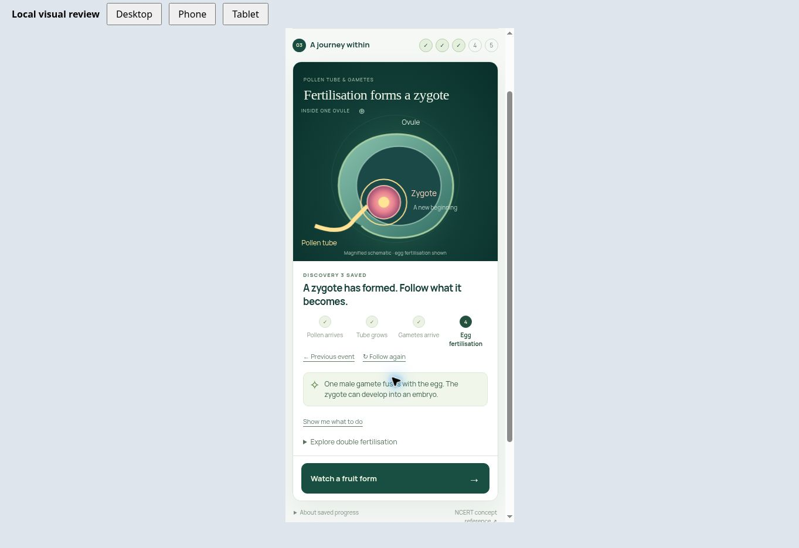
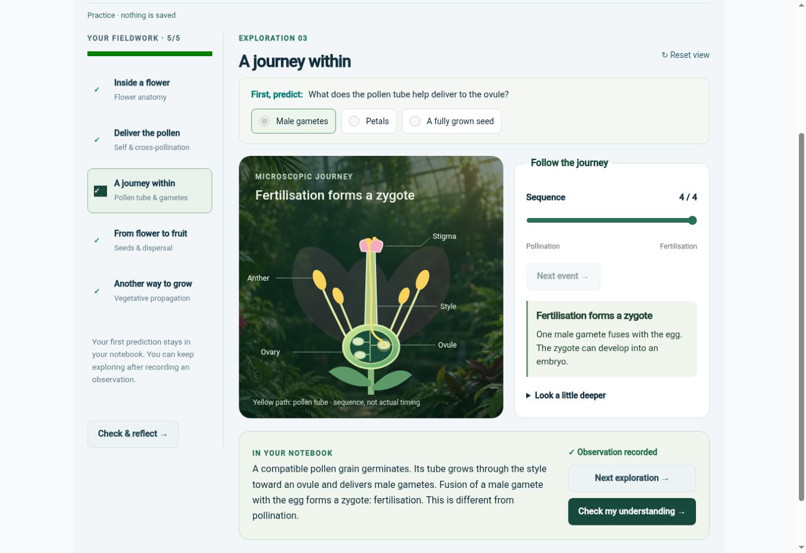

# Plant Reproduction visual review — 6 September 2026

## Version 2 redesign review

The redesigned lab has now been operated in the browser with the real GTOP header, sidebar and footer, using local account/storage substitutes. Desktop checks cover direct anatomy targets, unsuccessful and successful pollen trials, magnified tube and egg scenes, fruit/seed development, wind release, potato comparison and the discoveries summary. Phone checks at 390 × 844 cover entry, direct anatomy controls, unsuccessful pollen trials, magnified egg fertilisation and step orientation. The leaf interaction and the remaining variants passed the compiled interaction test; they were not all visually inspected. The existing review below records the version 1 baseline.

Visual findings corrected during version 2 review:

- Start immediately with the flower visible and tappable, with one clear next action.
- Keep the phone action bar visible within the GTOP shell; fix the outer overflow that prevented sticking.
- Bring the new instruction back into view when moving to another event.
- Replace duplicated long failed-pollen instructions with an actionable prompt.
- Selecting a new wind condition preserves the previous release result until another fruit is released.
- Replay stays interactive after completion; closing the leaf keeps the saved discovery.

Verification: production build passed with existing warnings, 11 domain/regression tests passed, the complete compiled Angular workflow passed, and the actual service/rules emulator checks passed (including new fieldwork and an empty initial baseline). No live learner records were created. Browser inspection establishes rendered interaction quality in the real shell; it does not verify a live signed-in Firebase session or unaided child use.

The final summary was subsequently shortened, with the assessment action moved above its review cards. The browser then rejected both new navigation and access to the already-open preview under its URL policy, despite the supervised preview remaining healthy. The final summary recheck and remaining phone variants are therefore pending. No alternate browser route was used after this denial.

## Version 1 baseline

The founder required an actual visual check before further design direction.

## Scope and evidence

Reviewed the current compiled Angular lesson in the browser using the existing isolated fixture and real lesson components/styles. Visually inspected all five desktop explorations and the assessment screen. Interacted with the entry and anatomy exploration inside a 390 × 844 CSS-pixel frame. Account services were simulated; this does not verify live sign-in, persistence or the complete GTOP shell.

## Observed findings

- The desktop entry's start buttons are below the first viewport. Its large specimen has no direct manipulation.
- The phone entry shows heading, navigation and the first question without a visible flower.
- The anatomy page is about 2231 CSS pixels tall at 390-pixel width. Using its controls leaves the top of the flower outside the visible area; the completion action is farther below.
- The microscopic journey retains the distant whole-flower view. Tube growth and fusion are small events within a large panel.
- Fruit development shows a small schematic fruit beside a dandelion question without a pictured dandelion.
- A successful compatible stigma transfer leaves Record observation disabled until the separate petal trial.
- Closing the already-inspected Bryophyllum example disables completion again.

## Proposed priority

Keep the active specimen, current instruction and relevant controls together, starting with the phone layout. Then develop coherent artwork, useful magnification and meaningful visible consequences. Preserve alternative trials and make completion requirements explicit. This is a proposal; the lesson itself was not redesigned in this review.

## Reproduce the local review

The existing fixture is `gtop-app/scripts/fixtures/plant-lab-preview.ts`. Its compiled output belongs in `gtop-app/dist/plant-preview/browser`. The new `dev` script serves that output using `scripts/plant-preview.vite.mjs`; `/review.html` supplies fixed desktop, phone and tablet frames without altering lesson styles.

Production build passed after adding the preview support. Existing bundle/style budget warnings remain. The preview tooling and this evidence are local review support pending the next source commit.
